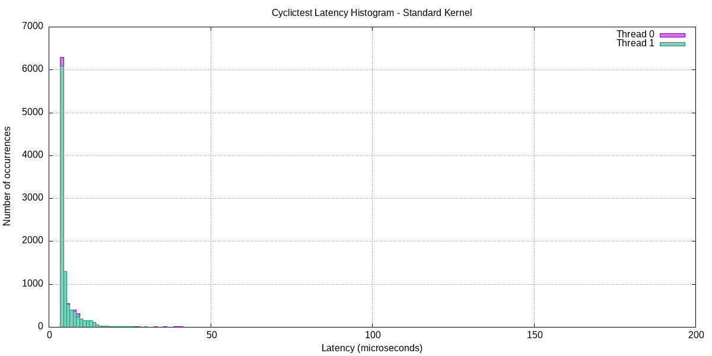

# LAB-03: Kernel Debugging & Embedded Application Performance Analysis


Third lab in the **LAB-01 → LAB-02 → LAB-03** series of the **Embedded Linux Systems** course.
It covers remote debugging with GDB, memory leak detection with Valgrind, profiling with strace/perf, and real-time latency measurement with cyclictest.

## Table of Contents

1. [Objectives](#1-objectives)
2. [Repository Structure](#2-repository-structure)
3. [Requirements](#3-requirements)
4. [How to Reproduce](#4-how-to-reproduce)
5. [Results](#5-results)
6. [Troubleshooting](#6-troubleshooting)
7. [References](#7-references)

---

## 1. Objectives

- **Part A – GDB remote debugging:** debug an ARM application running in QEMU using `gdb-multiarch` and `gdbserver`; set breakpoints and watchpoints, inspect backtraces and registers.
- **Part B – Valgrind:** detect and analyze memory leaks, read allocation stack traces, and verify that the fix removes the leaks.
- **Part C – strace / perf:** trace system calls, identify CPU hotspots, and determine the bottleneck (CPU-bound or I/O-bound).
- **Part D – cyclictest:** measure min/avg/max latency on the standard kernel, plot a histogram, and compare with PREEMPT_RT in theory.

---

## 2. Repository Structure

```
embedded_lab3/
├── apps/       # Source code and binaries of the test applications
├── rootfs/     # LAB-03 initramfs rootfs (with gdbserver and ARM binaries)
├── output/     # initramfs_lab3.cpio.gz – bootable image for QEMU
└── logs/       # Logs, reports and plots for Parts A–D
```

### `apps/`

| File | Description | Architecture |
|---|---|---|
| `buggy_app.c` | 3 intentional bugs: array out-of-bounds, use-after-free, integer overflow | ARMv7 (`-g -O0`) |
| `leaky_app.c` | Intentional memory leaks in `delete_record()` and `process_messages()` | x86_64 and ARMv7 |
| `leaky_app_fixed` | Corrected version with all leaks fixed | x86_64 |
| `perf_target.c` | CPU-bound, linear-search and I/O-heavy workloads | x86_64 and ARMv7 |

### `logs/`

| File | Content |
|---|---|
| `gdb_session.txt` | Remote debugging session log (breakpoints, backtrace, registers) |
| `valgrind_report.txt` | Valgrind report **before** the fix |
| `valgrind_fixed.txt` | Valgrind report **after** the fix |
| `strace_full.txt`, `strace_summary.txt` | Full syscall trace and `strace -c` summary |
| `perf_report.txt`, `perf_stat.txt` | `perf report` and `perf stat` output |
| `hist_standard.txt` | cyclictest histogram data (standard kernel) |
| `latency_histogram.png` | Latency histogram plotted with gnuplot |
| `flamegraph.svg` | (Bonus) Flame graph of `perf_target` |

---

## 3. Requirements

- Ubuntu x86_64 host with QEMU system ARM
- Cross toolchain: `arm-linux-gnueabihf-gcc`
- Debugging and profiling tools:

```bash
sudo apt install -y gdb-multiarch gdbserver valgrind strace \
                    linux-tools-common linux-tools-generic \
                    rt-tests gnuplot stress-ng
```

- Files reused from LAB-01:

```bash
ls ~/embedded_lab1/output/zImage
ls ~/embedded_lab1/output/vexpress-v2p-ca9.dtb
```

> **Note:** the `gdbserver` placed in the target rootfs must be an **ARM ELF** binary, not x86_64. Verify with `file $(which gdbserver)`.

---

## 4. How to Reproduce

### Part A – Remote debugging with GDB

**1. Cross-compile with debug symbols**

```bash
cd apps
arm-linux-gnueabihf-gcc -g -O0 -march=armv7-a -mfpu=neon-vfpv3 -mfloat-abi=hard \
    -o buggy_app buggy_app.c
cp buggy_app ../rootfs/initramfs/usr/bin/
```

**2. Pack the initramfs**

```bash
cd rootfs/initramfs
find . | cpio -H newc -o | gzip > ../../output/initramfs_lab3.cpio.gz
```

**3. Terminal 1 – Boot QEMU (with port 1234 forwarded)**

```bash
qemu-system-arm -M vexpress-a9 -cpu cortex-a9 -m 512M -smp 2 -nographic \
  -kernel ~/embedded_lab1/output/zImage \
  -dtb ~/embedded_lab1/output/vexpress-v2p-ca9.dtb \
  -initrd output/initramfs_lab3.cpio.gz \
  -append 'console=ttyAMA0,115200 rdinit=/sbin/init mem=512M' \
  -net nic -net user,hostfwd=tcp::1234-:1234
```

In the QEMU shell:

```bash
gdbserver :1234 /usr/bin/buggy_app
```

**4. Terminal 2 – Connect GDB from the host**

```bash
cd apps
gdb-multiarch buggy_app
(gdb) set architecture arm
(gdb) set sysroot ../rootfs/initramfs
(gdb) target remote localhost:1234
(gdb) break process_data
(gdb) continue
(gdb) backtrace
(gdb) info registers pc sp lr
```

### Part B – Memory leak analysis with Valgrind

```bash
cd apps
gcc -g -O0 -o leaky_app leaky_app.c

valgrind --tool=memcheck --leak-check=full --show-leak-kinds=all \
         --track-origins=yes --log-file=../logs/valgrind_report.txt ./leaky_app
```

After uncommenting `free(r->name)` and `free(r->scores)`, and adding `free(buf)`:

```bash
gcc -g -O0 -o leaky_app_fixed leaky_app.c
valgrind --leak-check=full --log-file=../logs/valgrind_fixed.txt ./leaky_app_fixed
```

Measure memory usage on the ARM target (inside QEMU):

```bash
leaky_app_arm &
PID=$!
grep -E 'VmRSS|VmSize' /proc/$PID/status
```

### Part C – Profiling with strace and perf

```bash
cd apps
gcc -g -O1 -o perf_target perf_target.c -lm

# strace
strace -o ../logs/strace_full.txt ./perf_target
strace -c -o ../logs/strace_summary.txt ./perf_target

# perf
sudo perf record -g -o ../logs/perf.data ./perf_target
sudo perf report -i ../logs/perf.data --stdio > ../logs/perf_report.txt
sudo perf stat ./perf_target 2>&1 | tee ../logs/perf_stat.txt
```

### Part D – Latency measurement with cyclictest (run on the host)

```bash
# Terminal 1: generate system load
stress-ng --cpu $(nproc) --io 4 --vm 2 --vm-bytes 256M --timeout 60s

# Terminal 2: measure latency
sudo cyclictest --mlockall --threads=4 --priority=80 --interval=1000 \
  --distance=500 --loops=10000 --histogram=200 \
  --histfile=logs/hist_standard.txt

# Plot the histogram
gnuplot logs/plot_latency.gnuplot
```

---

## 5. Results

> Fill in the actual values from the files in `logs/`.

### 5.1. GDB – The three bugs found

| # | Bug | Location (file:line) | Variable values at failure | Fix |
|---|---|---|---|---|
| 1 | Array out-of-bounds | `buggy_app.c:__` | `i = __` | Change `i <= len` to `i < len` |
| 2 | Use-after-free | `buggy_app.c:__` | `buf = 0x____` | Do not `free` the buffer before returning it |
| 3 | Integer overflow | `buggy_app.c:__` | `result = ____` | Use `int64_t` or check for overflow |

### 5.2. Valgrind

| | Before fix | After fix |
|---|---|---|
| Definitely lost | __ bytes in __ blocks | 0 |
| Indirectly lost | __ bytes in __ blocks | 0 |
| Total heap usage | __ allocs, __ frees | __ allocs, __ frees |
| ERROR SUMMARY | __ errors | 0 errors from 0 contexts |

### 5.3. strace and perf

**Top 5 system calls (`strace -c`):**

| Syscall | % time | Calls |
|---|---|---|
| __ | __ | __ |

**Top 5 CPU-consuming functions (`perf report`):**

| Symbol | Overhead | Shared object |
|---|---|---|
| `heavy_compute` | __ % | `perf_target` |

**Conclusion:** the bottleneck of `perf_target` is `__` (CPU / I/O). Suggested optimization: `__`.

### 5.4. cyclictest – Standard kernel

| Metric | Result |
|---|---|
| Min latency | __ µs |
| Avg latency | __ µs |
| Max latency | __ µs |
| Kernel version | `__` |
| PREEMPT config | `__` |
| Load during test | `stress-ng` (cpu + io + vm) |



---

## 6. Troubleshooting

| Error | Solution |
|---|---|
| `Connection refused` on `target remote` | Check that `gdbserver :1234` is running in QEMU and the port is forwarded |
| `Cannot find shared library` | Reset with `set sysroot ~/embedded_lab3/rootfs/initramfs` |
| `perf: Permission denied` | Use `sudo perf` or `echo 0 > /proc/sys/kernel/perf_event_paranoid` |
| `SCHED_FIFO permission denied` | Run `cyclictest` with `sudo` |
| `gdbserver: not found` inside QEMU | Copy the ARM gdbserver to `rootfs/initramfs/usr/bin/` and repack the initramfs |

---

## 7. References

- *Embedded Linux Primer* (2nd Ed.) – Chapters 16, 17, 18, 19
- [GDB Documentation](https://sourceware.org/gdb/documentation/)
- [Valgrind User Manual](https://valgrind.org/docs/manual/)
- [perf Wiki](https://perf.wiki.kernel.org/index.php/Main_Page)
- [PREEMPT_RT Wiki](https://wiki.linuxfoundation.org/realtime/documentation/)
- [Brendan Gregg – FlameGraph](https://github.com/brendangregg/FlameGraph)

---

*LAB-03 – Embedded Linux Systems.*